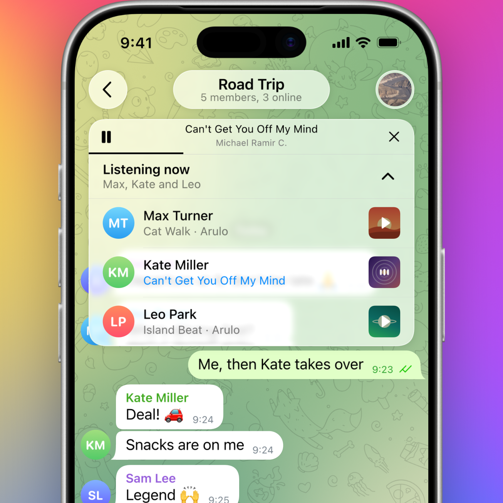

# Listen Along for Telegram iOS

See what a friend is listening to and play it yourself in one tap. A contact who is playing music shows it in the chat list, the chat offers the track under the navigation bar, and in groups you can see who is listening to what and play any of their tracks.

[](Media/demo.mp4)

▶︎ [Media/demo.mp4](Media/demo.mp4) — the concept, animated (18 s, with sound).

## Why

Music is one of the most shared things in chats, but sharing it means sending a file and waiting for the other person to open it. There is no way to just see what a friend is listening to right now and join in.

This concept adds that moment using what Telegram already has: chat activities ("typing…"), the panels above the chat, the media player and the voice-chat indicator. Nothing new to learn, no new visual language.

## What it does

- **Chat list.** A contact who is listening gets the live-audio marker on the avatar (the voice chat's bars), and the preview turns into "listening to <track>" — the slot "typing…" uses.
- **Private chat.** A panel under the navigation bar: "<Name> is listening", the track, and a **Listen** button. Listen starts the track in your own player, and the panel hands over to the standard now-playing panel.
- **Group.** A "Listening now" panel with the listeners' avatars (the voice-chat panel's layout). A tap opens it into a list: every member, their track, and a play button.

## How it works

| Piece | Where |
| --- | --- |
| Who is listening to what, the panel (private and group) | `ChatListenAlongPanel.swift` (new) |
| The panel among the chat's header panels | `ChatControllerNode.swift` |
| Activity text and live-audio marker in the chat list | `ChatListItem.swift` |

- **Panels.** The panel is a component in the chat's `HeaderPanelContainerComponent`, after the voice-chat panel, so it shares the glass, stacking and transitions of the existing panels. Layouts follow the pinned-message panel (private) and the voice-chat panel (group).
- **Playing.** Listen and the list's play buttons open the track's message, so the app's own player and media panel take over.
- **Data.** The server has no "now playing" status yet. In this prototype, a track a member shared in the chat during the last 24 hours stands in for it (read from the chat's music through `chatHistoryViewForLocation`, no Postbox access). A production version would receive the status the way typing activities arrive.

## Repository

| Path | What |
| --- | --- |
| `changes.patch` | The whole feature as one patch for Telegram-iOS: 3 files, +430 |
| `Sources/` | The new file from the patch, for reading |
| `Media/demo.mp4` | The concept, animated |

## Changes

| File | Change |
| --- | --- |
| `submodules/TelegramUI/Sources/ChatListenAlongPanel.swift` | New: listeners' data and the panel component |
| `submodules/TelegramUI/Sources/ChatControllerNode.swift` | Subscribes to the data, adds the panel to the header panels |
| `submodules/ChatListUI/Sources/Node/ChatListItem.swift` | "listening to …" preview and the live-audio marker |

## Trying it

Apply the patch to a checkout of [TelegramMessenger/Telegram-iOS](https://github.com/TelegramMessenger/Telegram-iOS) (made against `master` at `24638bc69b`, 3 Nov 2026) and build the app as usual:

```sh
git apply changes.patch
```

Ask a friend to send a music file to your chat or a group: the chat list, the chat and the group show them as listening for 24 hours.

## Limitations

- **No real "now playing" status.** A shared track stands in for it; the server would have to send the status.
- **Title activity not in the patch.** The video shows "listening to …" under the chat title; that needs a new activity kind from the server, so the title is unchanged.
- **Covers.** The panel shows a note icon instead of the track's album art.
- **New strings are not localized** (English only).
- **Verified:** the app builds for the simulator. **Not verified:** the feature in a running app on a device.
- **The video is a concept render**, not a screen recording. Names and messages are invented; music: SABINA — "Дагестан", plus free tracks from Mixkit.

## License

Telegram-iOS is distributed under the GNU General Public License v2.0, and so is this patch. See [LICENSE](LICENSE).
